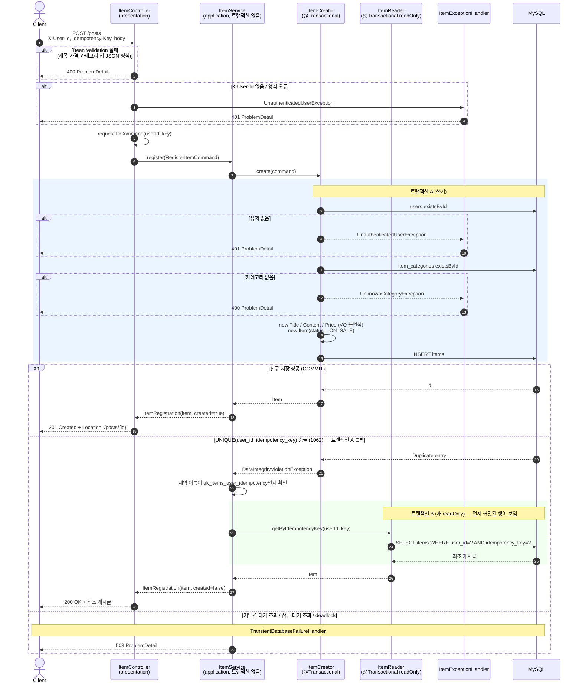
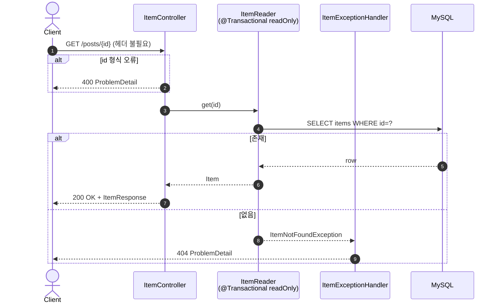
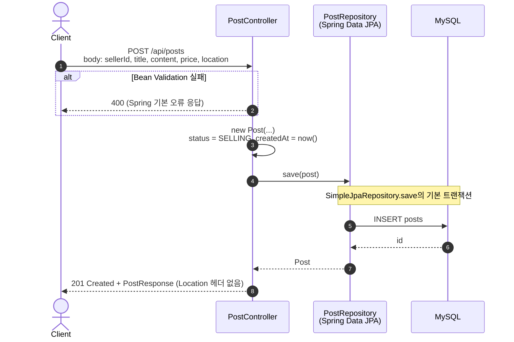

# karrot-compare

같은 "중고물품 판매 게시글 등록 API"를 두 방식으로 만든 비교 프로젝트입니다.

| 디렉터리 | 방식 | 프롬프트 |
|---|---|---|
| [`with-design/`](with-design) | 요구사항 + 설계를 주고 서브에이전트(planner → architect → developer → tester → qa) 파이프라인으로 개발 | [01-post-create-requirements.md](with-design/docs/01-post-create-requirements.md) |
| [`no-design/`](no-design) | 설계 없이 한 줄 프롬프트로 개발 | [01-post-create-prompt.md](no-design/docs/01-post-create-prompt.md) |

버그율 측정: [docs/bug-rate-comparison.md](docs/bug-rate-comparison.md) — 51개 시나리오(요구서 기반 24 + 일반 API 행동 27)에서 with-design 1건(2.0%), no-design 14건(27.5%) 실패

with-design 문서: [설계서](with-design/docs/02-post-create-design.md) · [QA 보고서](with-design/docs/03-post-create-qa.md)

## 실행

```bash
docker compose up -d                       # MySQL 9.7 (localhost:3307), DB 2개 생성
cd with-design && ./gradlew bootRun        # :8081
cd no-design   && ./gradlew bootRun        # :8082
```

스택: Spring Boot 4.1, Java 25, Spring Data JPA, MySQL 9.7. DB 계정(`karrot`/`karrot`, root `root`)은 로컬 개발용입니다.

## 시퀀스 다이어그램

### with-design — `POST /posts`



### with-design — `GET /posts/{id}`



### no-design — `POST /api/posts`



## 두 구현의 차이

| 항목 | with-design | no-design |
|---|---|---|
| 경로 | `POST /posts` (요구서대로) | `POST /api/posts` |
| 작성자 | `X-User-Id` 헤더 → 존재 확인, 없으면 401 | 본문의 `sellerId`를 존재 확인 없이 그대로 저장 |
| 등록 버튼 연타 | `Idempotency-Key` + UNIQUE 제약 + 트랜잭션 밖 재조회 → 1건 저장, 두 번째는 200 | 중복 방지 장치 없음 (코드 기준, 실행 검증은 안 함) |
| 카테고리 | `categoryId` 필수, 존재 확인 | 없음 |
| 네고 가능 | 있음 (생략하면 false) | 없음 |
| 내용 | 비어도 됨 | `@NotBlank` → 비면 400 |
| 판매 상태 | `ON_SALE` / `SOLD` / `STOPPED` | `SELLING` / `RESERVED` / `SOLD` |
| 계층 | DDD 4계층: presentation → application → domain | Controller가 Repository 직접 호출 |
| 트랜잭션 | 생성(쓰기)과 재조회(readOnly) 분리 | `save()` 기본 트랜잭션 |
| 오류 응답 | ProblemDetail, 400/401/404/503 | Spring 기본 오류 응답 |
| 조회 API | `GET /posts/{id}` | 없음 |
| 스키마 | `schema.sql` (UNIQUE, FK, CHECK) | `ddl-auto=update` |
| 테스트 | 92개 (단위·WebMvc·통합·동시성) | 기본 `contextLoads` 1개 |
| 완료 기준 (동시 1만 건 중 9,500) | 3회 측정 모두 10,000/10,000 | 측정 안 함 |
